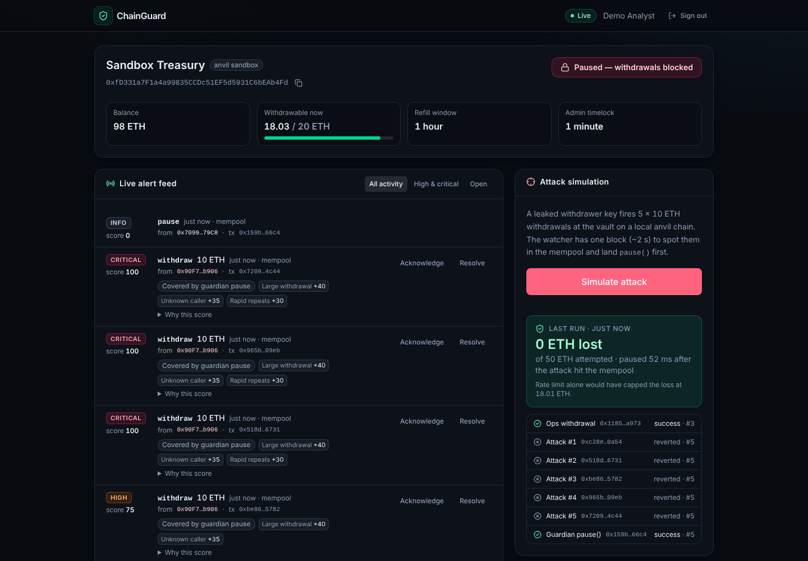
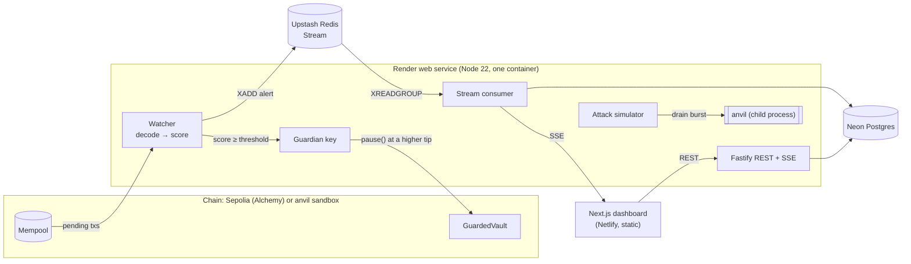
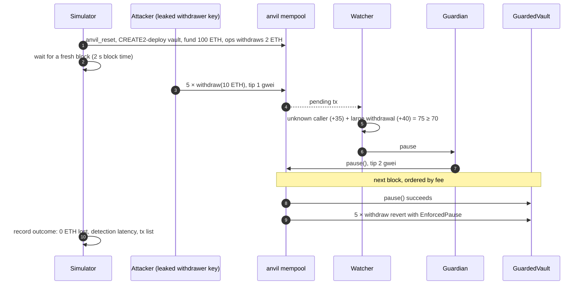

# ChainGuard

[](https://github.com/temitopeagbola/ChainGuard/actions/workflows/ci.yml)

**Live demo: https://chainguard.temitopeagbola.com** — click **Try the demo**, then **Simulate attack**.
(The API runs on Render's free tier; if it has been idle, the first request takes up to a minute while it wakes.)

ChainGuard is real-time security monitoring for smart contracts. A Node.js watcher subscribes to
pending transactions, decodes every call to a protected vault with viem, scores it against
detection rules and publishes alerts to a Redis Stream. When a withdrawal scores past the
threshold, a guardian key sends `pause()` with a higher priority fee, so the pause is mined
**before** the attack in the same block. The vault itself (Solidity, Foundry) backs this up on-chain
with a token-bucket withdrawal limit and a timelock on every admin change. The dashboard shows a
live alert feed and vault state, and has a button that fires a real drain attack at a vault on a
local anvil chain so you can watch the guardian stop it.



## Features

- **GuardedVault contract**: Pausable, AccessControl roles (admin, guardian, withdrawer), a per-window
  token-bucket rate limit, and an embedded timelock that guardians can veto. Role changes,
  limit changes and unpausing can only happen through the timelock.
- **Foundry test suite** (41 tests): unit, fuzz, invariant (outflow bounded by elapsed time),
  drain-attack scenarios, a re-entrancy attack and the deploy script. Sepolia deploy script included.
- **Mempool watcher**: Alchemy `alchemy_pendingTransactions` (filtered server-side) in production,
  standard `eth_subscribe` against anvil, plus a mock provider for key-less runs. It also scans mined
  blocks for transactions that never reached the public mempool.
- **Rules engine**: large withdrawal, unknown caller, rapid repeats, rate-limit drain and
  timelock-schedule rules. Each rule has a weight, the total is capped at 100 and mapped to a
  severity band, and every alert explains its score.
- **Guardian**: one `pause()` in flight per vault. It sends at double the attacker's effective tip and
  fires before the Redis round-trip.
- **Redis Streams pipeline**: consumer group, acks only after the Postgres write, `XAUTOCLAIM`
  recovery for crashed consumers, and a dead-letter stream for invalid messages.
- **Dashboard**: one-click demo login, live feed over server-sent events, alert triage
  (acknowledge/resolve), vault state with a rate-limit meter, attack simulator with a step
  timeline, a "waking the server…" state for cold starts, and a layout that works down to 375px.
- **Real persistence**: Postgres for users, vaults, alerts and simulations, with seeded demo data.

## Architecture



The watcher and the API only communicate through the Redis Stream. They share one process because
Render's free tier has no background workers (`ROLE=all`). Set `ROLE=api` / `ROLE=watcher` to split
them.

### What happens when you press "Simulate attack"



The simulator never calls `pause()` itself; stopping the attack is entirely up to the watcher. The
vault is always deployed through the deterministic CREATE2 factory with the same salt, so it lands
at the same address after every reset and the watcher needs no coordination. If the guardian loses
the race, the rate limit still caps the loss (the UI shows the cap).

## The contract

`packages/contracts/src/GuardedVault.sol`

| Layer      | Mechanism                                                                                                                                                                                              | Who                                                       |
| ---------- | ------------------------------------------------------------------------------------------------------------------------------------------------------------------------------------------------------ | --------------------------------------------------------- |
| Rate limit | Token bucket: `withdrawLimit` wei capacity, refilling linearly over `windowDuration`. A leaked withdrawer key can drain at most that rate.                                                             | enforced on every `withdraw`                              |
| Pause      | `pause()` is instant and idempotent. `unpause()` is timelocked, can only be queued while paused, and only lifts the pause it was queued against, so a stolen admin key cannot undo an emergency pause. | `GUARDIAN_ROLE`                                           |
| Timelock   | `schedule(data, salt)` → wait `timelockDelay` → `execute`. Only `grantRole`, `revokeRole`, `setRateLimit`, `setTimelockDelay` and `unpause` can be queued.                                             | `ADMIN_ROLE` schedules; guardians and admins can `cancel` |
| Roles      | The vault holds `DEFAULT_ADMIN_ROLE` itself and can never hand it out, so role changes _must_ go through the timelock.                                                                                 | —                                                         |

## Detection rules

| Rule                | Weight | Fires when                                                       |
| ------------------- | -----: | ---------------------------------------------------------------- |
| Large withdrawal    |     40 | a withdrawal is ≥ `LARGE_WITHDRAWAL_BPS` of the balance (10%)    |
| Unknown caller      |     35 | a state-changing call comes from an address not on the allowlist |
| Rapid repeats       |     30 | one sender makes ≥ 3 calls within 60 s                           |
| Rate-limit drain    |     15 | a withdrawal uses ≥ 80% of the remaining bucket                  |
| Admin change queued |     30 | `schedule()` is called (the alert names the queued call)         |

The score is the sum of the weights, capped at 100. Severity bands: info < 20 ≤ low < 40 ≤ medium <
60 ≤ high < 80 ≤ critical. Only withdrawals trigger an automatic pause (`PAUSE_THRESHOLD`, default
70). Pausing does not stop a queued admin change, so those alert a human, who can `cancel` during
the delay.

## Repository layout

```
apps/
  api/          Fastify API, watcher, guardian, Redis Streams, simulator (Node 22, TypeScript)
  web/          Next.js 16 dashboard, static export for Netlify
packages/
  contracts/    Foundry project: GuardedVault, tests, Sepolia deploy script
  shared/       Wire types, formatting helpers, generated vault ABI + bytecode
e2e/            Playwright smoke test
docs/           Build plan and screenshots
docker-compose.yml  render.yaml  netlify.toml  .env.example
```

## Run it locally

### Everything in Docker (one command)

```bash
git clone https://github.com/temitopeagbola/ChainGuard.git && cd ChainGuard
docker compose up --build
```

Open http://localhost:3000 and click **Try the demo**. Compose runs Postgres, Redis, anvil, the API
(:4000) and the dashboard (:3000).

### Development mode (hot reload)

Requires Node 22+ and [Foundry](https://book.getfoundry.sh/getting-started/installation)
(`anvil` on your `PATH`).

```bash
git submodule update --init           # forge-std + OpenZeppelin, only needed for the contracts
npm install
docker compose up -d postgres redis   # or point .env at your own
cp .env.example .env                  # defaults work as-is; the API spawns anvil itself
                                      # personal overrides go in .env.local (wins over .env)
npm run dev:api                       # http://localhost:4000
npm run dev:web                       # http://localhost:3000
```

## Tests

| Command                                       | What it covers                                                                                                                                                                                                                                                                                                             |
| --------------------------------------------- | -------------------------------------------------------------------------------------------------------------------------------------------------------------------------------------------------------------------------------------------------------------------------------------------------------------------------- |
| `cd packages/contracts && forge test`         | 41 Foundry tests: unit, fuzz, invariant, drain attack, re-entrancy, deploy script                                                                                                                                                                                                                                          |
| `npm test`                                    | 91 Vitest tests: rules engine, decoder, watcher pipeline, the Alchemy subscription client (against a fake Alchemy WebSocket server), fees, auth, config, SSE/API clients; integration tests of the HTTP API and stream pipeline against Postgres + Redis; and the **full attack simulation on anvil** (asserts 0 ETH lost) |
| `npm run test:e2e`                            | Playwright: demo login → live feed → simulate attack → vault paused, 0 ETH lost → acknowledge an alert                                                                                                                                                                                                                     |
| `npm run lint` / `typecheck` / `format:check` | ESLint, `tsc` (strict) across all packages, Prettier                                                                                                                                                                                                                                                                       |

Integration and e2e tests need Postgres and Redis: start them with
`docker compose up -d postgres redis` and export `TEST_DATABASE_URL` / `TEST_REDIS_URL` (see
`.env.example`). Locally they skip without them; in CI they always run. GitHub Actions runs all of
the above on every push and pull request, plus `docker compose build`.

## Deploy

All free tiers. The dashboard deploys from `main` to the existing Netlify site; the API deploys to
Render.

1. **Postgres on Neon**: create a project and copy the **pooled** connection string (it ends in
   `?sslmode=require`).
2. **Redis on Upstash**: create a Redis database in the region closest to your Render region and
   copy the `rediss://` URL.
3. **API on Render**: _New → Blueprint_, pick this repo. `render.yaml` defines a free Docker web
   service in `frankfurt` (create Neon and Upstash in an EU/Frankfurt region too, or change
   `region`). Paste `DATABASE_URL` and `REDIS_URL` when prompted (`JWT_SECRET` is generated). The
   image includes anvil, so the sandbox runs inside the same container. Note the service URL, e.g.
   `https://chainguard-api.onrender.com`. Migrations and demo data run on boot.
4. **Dashboard on Netlify**: the site is already linked to this repo with its custom domain.
   `netlify.toml` builds `apps/web` and publishes `out`. Set `NEXT_PUBLIC_API_URL` to the Render
   URL under _Site configuration → Environment variables_, then redeploy (or merge to `main`).
5. **Optional: live monitoring on Sepolia**
   1. Create an Alchemy app on Ethereum Sepolia and note its WebSocket and HTTPS URLs.
   2. Create a dedicated guardian key and fund it with a little Sepolia ETH.
   3. Deploy the vault, signing with an encrypted keystore (no plaintext keys):
      ```bash
      cast wallet import deployer --interactive
      cd packages/contracts
      export SEPOLIA_RPC_URL=… ETHERSCAN_API_KEY=… VAULT_ADMIN=0x… VAULT_GUARDIAN=0x… VAULT_WITHDRAWERS=0x…
      forge script script/Deploy.s.sol --rpc-url sepolia --account deployer --broadcast --verify
      ```
   4. On Render set `LIVE_PROVIDER=alchemy`, `ALCHEMY_WS_URL`, `SEPOLIA_RPC_URL`,
      `LIVE_VAULT_ADDRESS`, `LIVE_KNOWN_CALLERS` (admin + withdrawers) and `GUARDIAN_PRIVATE_KEY`.
      To try the live panel without any keys, set `LIVE_PROVIDER=mock` instead.

## Environment variables

Every variable is documented in [`.env.example`](.env.example). The ones you set when deploying:

| Variable                                                    | Where                      | Purpose                                                                |
| ----------------------------------------------------------- | -------------------------- | ---------------------------------------------------------------------- |
| `DATABASE_URL`                                              | Render                     | Neon pooled connection string                                          |
| `REDIS_URL`                                                 | Render                     | Upstash `rediss://` URL                                                |
| `JWT_SECRET`                                                | Render                     | Session signing key (generated by the blueprint)                       |
| `CORS_ORIGINS`                                              | Render                     | Dashboard origin(s), preset to `https://chainguard.temitopeagbola.com` |
| `SANDBOX_ANVIL_SPAWN`, `SANDBOX_RPC_URL`, `SANDBOX_WS_URL`  | Render                     | Run anvil inside the container (preset)                                |
| `SANDBOX_FORK_URL`                                          | Render (optional)          | Fork Sepolia for the sandbox instead of an empty chain                 |
| `LIVE_PROVIDER`                                             | Render                     | `off` (default), `mock`, or `alchemy`                                  |
| `ALCHEMY_WS_URL`, `SEPOLIA_RPC_URL`                         | Render (live only)         | Alchemy Sepolia endpoints                                              |
| `LIVE_VAULT_ADDRESS`, `LIVE_KNOWN_CALLERS`                  | Render (live only)         | Deployed vault and its normal operators                                |
| `GUARDIAN_PRIVATE_KEY`                                      | Render (live only, secret) | Key holding `GUARDIAN_ROLE` on Sepolia                                 |
| `PAUSE_THRESHOLD`, `LARGE_WITHDRAWAL_BPS`, `RAPID_REPEAT_*` | Render (optional)          | Detection tuning                                                       |
| `NEXT_PUBLIC_API_URL`                                       | Netlify                    | Render API URL, baked into the static build                            |

## Stack substitutions

| Planned                       | Used                                                                         | Why                                                                                                                                                                                                                                                                                                                                                                                                                            |
| ----------------------------- | ---------------------------------------------------------------------------- | ------------------------------------------------------------------------------------------------------------------------------------------------------------------------------------------------------------------------------------------------------------------------------------------------------------------------------------------------------------------------------------------------------------------------------ |
| Kafka                         | **Redis Streams** (Upstash)                                                  | There is no free hosted Kafka. Redis Streams provide what this pipeline needs from Kafka: an append-only log, consumer groups, per-message acks, redelivery of unacked messages (`XAUTOCLAIM`) and bounded retention (`MAXLEN`). We lose partitioning and long retention, which a single-vault MVP does not need. The producer and consumer sit behind small interfaces, so moving to Kafka later means replacing two classes. |
| Separate watcher worker       | Watcher inside the API process (`ROLE=all`)                                  | Render's free tier only offers web services. The halves still talk only through the stream, and `ROLE=api` / `ROLE=watcher` splits them.                                                                                                                                                                                                                                                                                       |
| anvil fork as its own service | anvil as a child process of the API on Render (its own container in compose) | Render free web services cannot run sidecars. Fork mode is optional (`SANDBOX_FORK_URL`). Without it the sandbox starts from an empty chain, which keeps the demo fast and needs no RPC key.                                                                                                                                                                                                                                   |
| Alchemy key required          | Mock provider when keys are absent                                           | `LIVE_PROVIDER=mock` replays scripted, clearly labelled traffic through the real watcher, and tests use an injectable mock source. The Alchemy integration is fully implemented and switches on with `LIVE_PROVIDER=alchemy`.                                                                                                                                                                                                  |
| Next.js server rendering      | Static export                                                                | The dashboard is client-side and talks to the API directly. Static files on Netlify have no server to cold-start and nothing to keep in sync with the Netlify runtime.                                                                                                                                                                                                                                                         |

## Security notes and known trade-offs

- **Private keys**: none are committed. The sandbox uses anvil's public dev mnemonic, which only signs
  for chain 31337. The sandbox refuses to run against any other chain id and forces anvil's chain id
  to 31337 even when forking. The Sepolia guardian key is a Render secret; production would use a
  KMS or a relayer (e.g. OpenZeppelin Defender) rather than a hot key in an environment variable.
- **Public mempool only**: transactions sent through private orderflow (Flashbots) skip the mempool.
  The watcher also scores mined blocks, but by then the on-chain rate limit is what bounds the loss.
  That is the reason the vault has it.
- **Front-running is a race**: the guardian outbids the attacker's tip (capped at 1000 gwei). An
  attacker willing to pay more can still win a block. The rate limit is the backstop.
- **Sessions** use a 12 h bearer token in `localStorage`, because the API and dashboard are on
  different sites, where third-party cookies are unreliable. The Netlify CSP restricts script and
  frame sources to reduce XSS exposure.
- **Demo account** is shared and cannot sign in with a password, only through `POST /auth/demo`.
  Auth routes are rate-limited, and simulations are rate-limited per session and serialised (one
  at a time).
- **Single-instance fan-out**: SSE is fanned out in-process. Running more than one API instance
  would need a per-instance `XREAD` tail or Redis pub/sub.
- **Upstash free tier** has a command budget, so the consumer blocks for 20 s per read
  (`STREAM_BLOCK_MS`) and the stream is trimmed to about 5,000 entries.
